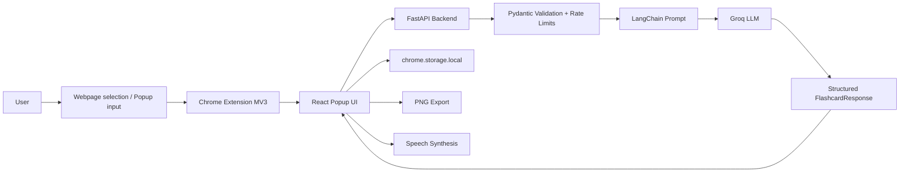

# LexiCard – AI-Powered Vocabulary Companion

LexiCard is an AI-powered Chrome extension that helps you learn English vocabulary while you browse. Select an unfamiliar word on any page, or type a word into the popup, and LexiCard generates a structured flashcard with definition, pronunciation, examples, synonyms, and a memory tip.

---

## 1. Project Introduction

**Problem:** Encountering unfamiliar English words while reading online usually means switching tabs, skimming incomplete dictionary entries, and forgetting the word later.

**Objective:** Give learners a fast, delightful vocabulary workflow:

- Capture words from webpages or manual input
- Generate clear, structured AI flashcards
- Save them locally for review
- Export flashcards as PNG images
- Hear pronunciation through the browser’s speech synthesis API

LexiCard uses a Hogwarts-inspired UI in the Chrome popup and a FastAPI backend that calls Groq through LangChain with structured Pydantic validation.

---

## 2. Features

- AI-powered vocabulary flashcard generation
- Right-click context menu capture for selected text
- Manual vocabulary entry in the popup
- Definitions in simple English
- Parts of speech
- IPA pronunciation
- Practical example sentences
- Synonyms
- Memory tips
- Text-to-speech pronunciation (when the browser supports it)
- Recently saved vocabulary history
- Local flashcard storage (`chrome.storage.local`)
- Downloadable flashcard PNG export
- Hogwarts-inspired popup design

---

## 3. Screenshots

Add real screenshots here before publishing:

| View | Placeholder |
|------|-------------|
| Popup home | `docs/screenshots/popup-home.png` |
| Generated flashcard | `docs/screenshots/flashcard.png` |
| Context menu | `docs/screenshots/context-menu.png` |
| Saved history | `docs/screenshots/history.png` |

> Do not invent screenshots. Capture them from your local build and place them under `docs/screenshots/`.

---

## 4. Technology Stack

**Frontend / Extension**

- React 19
- Vite
- Chrome Extension Manifest V3
- `html-to-image` for PNG export
- Web Speech API for pronunciation

**Backend**

- Python 3.11+
- FastAPI
- Pydantic
- LangChain (`langchain-groq`, `langchain-core`)
- Groq LLM API

---

## 5. System Architecture



---

## 6. Project Directory Structure

```text
LexiCard/
├── README.md
├── .gitignore
├── docs/
│   └── SECURITY_AUDIT_REPORT.md
├── backend/
│   ├── .env.example
│   ├── requirements.txt
│   ├── pytest.ini
│   ├── app/
│   │   ├── main.py                 # FastAPI app, middleware, health
│   │   ├── config.py               # Environment configuration
│   │   ├── security.py             # Optional API key dependency
│   │   ├── middleware/security.py  # Rate limit, size limit, headers
│   │   ├── routes/flashcard_routes.py
│   │   ├── schemas/flashcard_schema.py
│   │   ├── services/flashcard_service.py
│   │   └── prompts/flashcard_prompt.py
│   └── tests/
└── extension/
    ├── public/
    │   ├── manifest.json
    │   └── background.js
    ├── src/
    │   ├── App.jsx
    │   ├── component/Flashcard.jsx
    │   └── services/
    │       ├── flashcardApi.js
    │       └── flashcardStorage.js
    ├── package.json
    ├── vite.config.js
    └── vitest.config.js
```

---

## 7. Prerequisites

- Google Chrome (latest recommended)
- Node.js 20+ and npm
- Python 3.11+
- A Groq API key from [https://console.groq.com](https://console.groq.com)

---

## 8. Installation Instructions

```bash
git clone <your-repo-url>
cd LexiCard
```

Then complete **Backend Setup**, **Frontend Setup**, and **Chrome Extension Installation** below.

---

## 9. Backend Setup

```bash
cd backend
python -m venv .venv

# Windows PowerShell
.\.venv\Scripts\Activate.ps1

# macOS / Linux
# source .venv/bin/activate

pip install -r requirements.txt
copy .env.example .env   # Windows
# cp .env.example .env   # macOS / Linux
```

Edit `backend/.env` and set a real `GROQ_API_KEY`.

Start the API:

```bash
# from backend/ with venv active
uvicorn app.main:app --reload --host 127.0.0.1 --port 8000
```

Health check: [http://127.0.0.1:8000/health](http://127.0.0.1:8000/health)

---

## 10. Frontend Setup

```bash
cd extension
npm install
npm run dev
```

Vite defaults to [http://localhost:5173](http://localhost:5173) for UI development. For Chrome extension usage, build the production bundle:

```bash
npm run build
```

The packed extension output is written to `extension/dist/`.

---

## 11. Chrome Extension Installation

1. Run `npm run build` inside `extension/`.
2. Open `chrome://extensions`.
3. Enable **Developer mode**.
4. Click **Load unpacked**.
5. Select the `extension/dist` folder.
6. Pin LexiCard from the Extensions menu.

Context menu usage:

1. Select a word on a webpage.
2. Right-click → **Explain with LexiCard**.
3. Open the LexiCard popup. The selected word is prefilled.
4. Click **Generate Flashcard**.

---

## 12. Environment Variables

### Backend (`backend/.env`)

| Variable | Required | Description |
|----------|----------|-------------|
| `GROQ_API_KEY` | Yes | Groq API secret (backend only) |
| `GROQ_MODEL` | No | Defaults to `openai/gpt-oss-20b` |
| `ENVIRONMENT` | No | `development` or `production` |
| `CORS_ORIGINS` | No | Comma-separated browser origins |
| `EXTENSION_ORIGIN_REGEX` | No | Chrome extension origin regex |
| `LEXICARD_API_KEY` | Recommended in production | Shared API key expected in `X-API-Key` |
| `RATE_LIMIT_REQUESTS` | No | Default `20` |
| `RATE_LIMIT_WINDOW_SECONDS` | No | Default `60` |
| `MAX_REQUEST_BYTES` | No | Default `4096` |
| `LLM_TIMEOUT_SECONDS` | No | Default `45` |
| `LOG_LEVEL` | No | Default `INFO` |

See `backend/.env.example`.

### Extension (`extension/.env`)

| Variable | Required | Description |
|----------|----------|-------------|
| `VITE_API_BASE_URL` | No | Defaults to `http://localhost:8000/api/v1` |
| `VITE_LEXICARD_API_KEY` | No | Must match backend `LEXICARD_API_KEY` when set |
| `VITE_API_TIMEOUT_MS` | No | Defaults to `50000` |

See `extension/.env.example`.

Never commit real secrets. Never put `GROQ_API_KEY` in extension env files.

---

## 13. Groq API Configuration

1. Create a Groq account and API key.
2. Store it only in `backend/.env` as `GROQ_API_KEY`.
3. Restart the backend after changing env vars.
4. If a key was ever committed to Git, **rotate it immediately** in the Groq console and purge history or treat the old key as burned.

---

## 14. API Documentation

Interactive Swagger docs are available only when `ENVIRONMENT` is not `production`:

- Docs: `http://127.0.0.1:8000/docs`

### `GET /`

Welcome/status payload.

### `GET /health`

Returns service health and whether an LLM key is configured.

Example:

```json
{
  "status": "healthy",
  "llm_configured": true
}
```

### `POST /api/v1/flashcards/generate`

Generates a vocabulary flashcard.

**Headers**

- `Content-Type: application/json`
- `X-API-Key: <LEXICARD_API_KEY>` (required only when backend key is configured)

**Request body**

```json
{
  "word": "eloquent",
  "mode": "general",
  "original_sentence": null
}
```

**Validation rules**

- `word`: required, 1–100 chars, letters/numbers/spaces/hyphens/apostrophes only
- `mode`: `general` | `movie` | `conversation` | `advanced`
- `original_sentence`: optional, max 500 chars
- unknown fields rejected
- request body size limited by `MAX_REQUEST_BYTES`

**Example response**

```json
{
  "word": "eloquent",
  "part_of_speech": "adjective",
  "pronunciation": "/ˈel.ə.kwənt/",
  "definition": "Able to express ideas clearly and persuasively.",
  "examples": [
    {
      "context": "Movie",
      "sentence": "Her eloquent speech moved the entire courtroom."
    },
    {
      "context": "Daily Conversation",
      "sentence": "He gave an eloquent explanation of the plan."
    }
  ],
  "synonyms": ["articulate", "fluent", "persuasive"],
  "memory_tip": "Think of someone who speaks with elegance."
}
```

**Possible status codes**

| Code | Meaning |
|------|---------|
| 200 | Success |
| 401 | Missing/invalid API key |
| 413 | Request too large |
| 422 | Validation error |
| 429 | Rate limited |
| 502/503/504 | Upstream/model/config/timeout failures |
| 500 | Unexpected server error (no stack traces returned) |

---

## 15. Vocabulary Flashcard Structure

Defined in `backend/app/schemas/flashcard_schema.py`:

- `word`
- `part_of_speech`
- `pronunciation`
- `definition`
- `examples[]` with `context` + `sentence`
- `synonyms[]`
- `memory_tip`

LLM output is validated against this schema before it is returned to the client.

---

## 16. Local Storage

Saved flashcards are stored in `chrome.storage.local` under the `flashcards` key.

- Records are sanitized on read/write
- Duplicate words are replaced (case-insensitive)
- Retention is capped at 200 flashcards
- No API keys or account credentials are stored

Context-menu selections are temporarily stored as `pendingWord` and removed when the popup loads.

---

## 17. Context Menu

The MV3 service worker (`extension/public/background.js`) creates a selection context menu item. Clicking it stores a bounded copy of the selected text. Opening the popup prefills the input; generation still requires an explicit user action.

---

## 18. Text-to-Speech

The flashcard speaker button uses `window.speechSynthesis` when available. If speech synthesis is unsupported or fails, LexiCard shows a simple alert and remains usable.

---

## 19. PNG Export

The Download button rasterizes an off-screen export card with `html-to-image` and downloads a PNG. Export failures are caught and surfaced without crashing the popup. Filenames are sanitized.

---

## 20. Testing

### Backend

```bash
cd backend
.\.venv\Scripts\Activate.ps1
pytest -q
```

Groq is mocked in automated tests; normal test runs should not consume API credits.

### Frontend

```bash
cd extension
npm test
```

### Security-focused backend suite

```bash
cd backend
pytest tests/test_security.py tests/test_validation.py -q
```

### Production extension build

```bash
cd extension
npm run build
```

> Full Playwright end-to-end testing of a loaded Chrome extension package is not included yet. Do not treat Vite page tests as complete MV3 extension E2E coverage.

---

## 21. Security Architecture

Implemented controls:

- Groq credentials stay on the backend only
- Pydantic validation for requests and LLM responses
- Input length / character restrictions
- Optional shared API key (`X-API-Key`)
- Per-IP rate limiting on generate
- Request size limits and LLM timeouts
- CORS allowlisting with restricted methods/headers
- Security response headers
- Safe exception handling without stack-trace leakage
- Prompt trust-boundary instructions and structured output enforcement
- Manifest V3 with minimal permissions (`contextMenus`, `storage`) and explicit CSP
- React text rendering (no `dangerouslySetInnerHTML`)
- Local storage sanitization and retention limits

For findings, residual risks, and publication status, see [`docs/SECURITY_AUDIT_REPORT.md`](docs/SECURITY_AUDIT_REPORT.md).

---

## 22. Privacy Considerations

- Selected webpage text / typed words are sent to your LexiCard backend to generate flashcards.
- The backend sends the vocabulary word (and optional sentence context, when provided) to Groq for generation.
- Saved flashcards are stored locally in the browser via `chrome.storage.local`.
- The backend does not implement durable flashcard persistence or user accounts in the current codebase.
- No analytics/tracking SDK is included in the current extension or backend code.
- Do not submit personal secrets or sensitive data as vocabulary input.

Publish a privacy policy URL before Chrome Web Store submission.

---

## 23. Known Limitations

- Backend must be reachable by the extension (`localhost` by default).
- Context menu prefills a word; it does not auto-generate or auto-save.
- Learning modes exist in the API but are not yet exposed as popup UI controls.
- In-memory rate limiting is per process (not distributed).
- Shared API keys embedded in extension builds can be extracted.
- Speech synthesis quality depends on the browser/OS voice pack.
- No official multi-user auth/billing layer.

---

## 24. Troubleshooting

| Issue | What to check |
|------|----------------|
| `Unable to reach the flashcard service` | Backend running? Correct `VITE_API_BASE_URL` / host permissions? |
| `Flashcard service is temporarily unavailable` | Is `GROQ_API_KEY` set? Is Groq reachable? |
| `Too many requests` | Wait for the rate-limit window or raise limits in `.env` |
| `Invalid or missing API key` | Extension `VITE_LEXICARD_API_KEY` must match backend `LEXICARD_API_KEY` |
| Context menu word not appearing | Open the popup after selecting; pending word is read on popup mount |
| PNG download fails | Retry; check console for canvas/font errors |

---

## 25. Deployment

Recommended production setup:

1. Deploy backend behind HTTPS (for example Railway, Fly.io, Render, or a VPS + reverse proxy).
2. Set `ENVIRONMENT=production`.
3. Set strong `LEXICARD_API_KEY`, tight CORS, and conservative rate limits.
4. Configure Groq billing alerts / spend caps.
5. Build the extension with `VITE_API_BASE_URL=https://your-api.example.com/api/v1`.
6. Update `manifest.json` `host_permissions` to your HTTPS API origin only.
7. Reload the unpacked build or package for the Chrome Web Store.

Do not use the Vite/Uvicorn reload development servers as a production deployment.

---

## 26. Contribution Guidelines

1. Fork and create a feature branch.
2. Keep changes focused; preserve existing UX unless the change requires UI updates.
3. Add or update tests for backend/frontend behavior you change.
4. Run `pytest` and `npm test` before opening a PR.
5. Never commit `.env` files or real API keys.

---


## 27 Security Policy

## Supported Versions

LexiCard is currently under active development. Security updates will be applied to the latest maintained version.

| Version | Supported |
|---------|-----------|
| Latest development version | Yes |
| Older versions | No |

## Reporting a Vulnerability

If you discover a security vulnerability in LexiCard, please report it responsibly.

**Please do not disclose security vulnerabilities publicly through GitHub Issues.**

Instead:

1. Contact the repository owner privately through GitHub.
2. Navigate to the repository's **Security** tab and use **Report a vulnerability** if private vulnerability reporting is enabled.
3. Include a clear description of the vulnerability, its potential impact, and steps to reproduce it.
4. If possible, include relevant screenshots or proof-of-concept details.

## Response Process

- Reports will be reviewed as soon as reasonably possible.
- Valid vulnerabilities will be investigated and prioritized.
- Security fixes will be implemented where necessary.
- Reporters will be informed when appropriate.

## Security Best Practices

When contributing to or using LexiCard:

- Never commit `.env` files or API credentials.
- Keep the Groq API key exclusively on the backend.
- Never expose backend secrets in the Chrome extension.
- Validate and sanitize incoming user input.
- Keep project dependencies updated.
- Do not share sensitive information in public bug reports.

Thank you for helping keep LexiCard secure.
